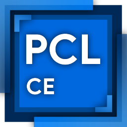
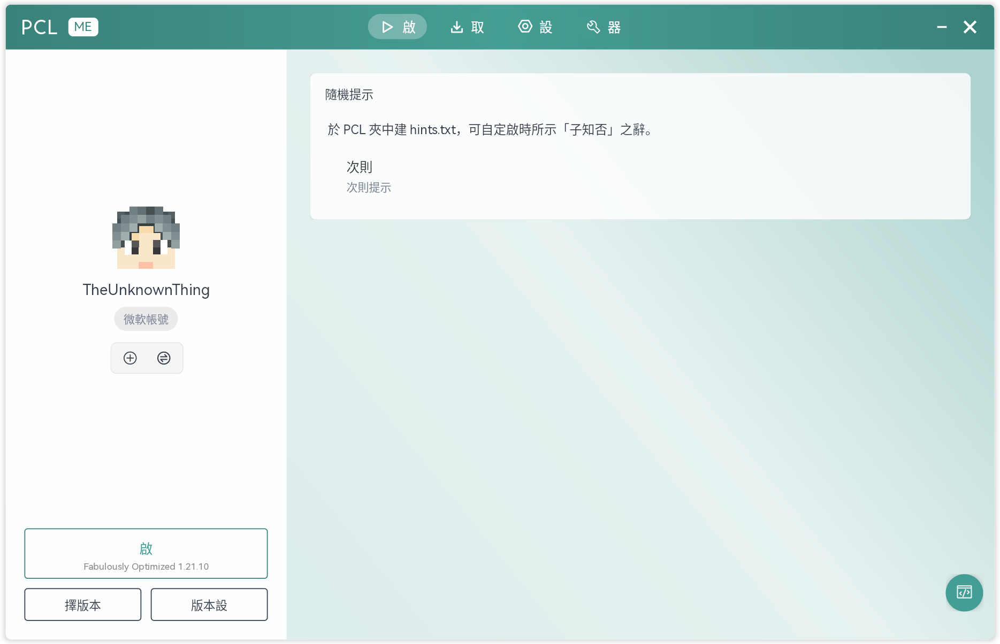
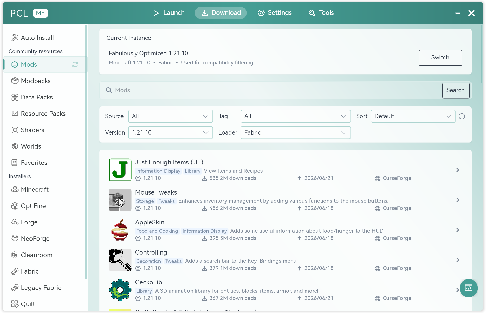
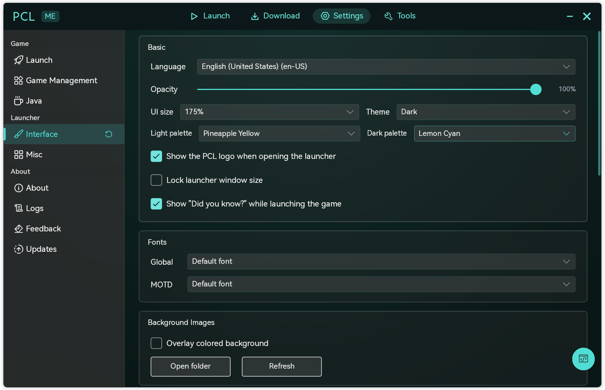

[English](README-EN.md) · [简体中文](README-ZH_CN.md) · **繁體中文**

<p align="center">
  
</p>

<h1 align="center">PCL Multiplatform Edition</h1>

<p align="center">
  熟悉的 PCL 體驗，現已來到 Windows、macOS 與 Linux。
</p>

<p align="center">
  <a href="#開始使用"></a>
  <a href="https://github.com/TheUnknownThing/PCL-ME/actions/workflows/build-test.yml"></a>
  <a href="https://github.com/TheUnknownThing/PCL-ME/releases"></a>
</p>

<p align="center">
  <a href="https://github.com/TheUnknownThing/PCL-ME/releases/latest"><strong>下載</strong></a> ·
  <a href="https://github.com/TheUnknownThing/PCL-ME/issues">回報問題</a> ·
  <a href="CONTRIBUTING.md">參與貢獻</a>
</p>

PCL-ME 是一款 Minecraft 啟動器，將 Plain Craft Launcher 熟悉的使用體驗帶到三大桌面平台。專案以 C#、.NET 10 與 Avalonia 開發，由 [PCL-CE](https://github.com/PCL-Community/PCL-CE) 分叉而來，目前作為獨立分支持續維護。

- **啟動遊戲** — 在同一介面管理遊戲實例，啟動 Minecraft。
- **探索資源** — 瀏覽模組、整合包、資源包與光影，為下一次冒險做好準備。
- **隨心自訂** — 調整主題、配色、語言與介面縮放，讓啟動器融入你的桌面。

## 介面預覽

<table align="center" width="760">
  <tr>
    <td colspan="2" align="center">
      <a href="docs/screenshots/launch.png"></a>
      <p>帳號、遊戲實例與啟動操作，盡在一處。</p>
    </td>
  </tr>
  <tr>
    <td width="50%" align="center" valign="top">
      <a href="docs/screenshots/download.png"></a>
      <p><strong>發現下一款心儀模組</strong><br>
      依版本與載入器篩選，探索社群資源。</p>
    </td>
    <td width="50%" align="center" valign="top">
      <a href="docs/screenshots/settings.png"></a>
      <p><strong>打造熟悉的使用體驗</strong><br>
      自由選擇主題、配色、語言與介面縮放。</p>
    </td>
  </tr>
</table>

## 開始使用

前往[最新發佈頁面](https://github.com/TheUnknownThing/PCL-ME/releases/latest)，下載適合你的作業系統與處理器架構的安裝套件。

| 平台 | 支援情況 |
| --- | --- |
| Windows | 已支援；測試涵蓋程度略少於 Linux 與 macOS。 |
| macOS | 主力平台，持續開發與測試。 |
| Linux | 主力平台，持續開發與測試。 |

Arch Linux 使用者也可以使用 `yay` 等 AUR 輔助工具安裝：

```sh
yay -S pcl-me-bin
```

## 從原始碼建置

安裝 **.NET 10 SDK**，然後在儲存庫根目錄執行：

```sh
dotnet restore
dotnet build
dotnet run --project PCL.Frontend.Avalonia/PCL.Frontend.Avalonia.csproj -- app
```

程式碼依桌面介面與共用啟動器服務分層組織：

| 專案 | 職責 |
| --- | --- |
| [PCL.Frontend.Avalonia](PCL.Frontend.Avalonia/README.md) | 桌面介面、主題、資源與應用程式封裝。 |
| [PCL.Core.Backend](PCL.Core.Backend/README.md) | 共用啟動器服務、Minecraft 啟動流程、下載與跨平台工具。 |

提交程式碼修改前，請執行 `dotnet test`。更詳細的建置、測試、封裝與疑難排解流程，請參閱上方專案文件。

## 參與貢獻

歡迎回報問題、完善文件或貢獻程式碼。開發流程與提交要求，請參閱[貢獻指南](CONTRIBUTING.md)。

回報問題時，請附上作業系統、啟動器與遊戲版本、重現步驟及日誌。如果你希望實作新功能，請先提交[功能提案](https://github.com/TheUnknownThing/PCL-ME/issues/new?template=3-feature.yml)，與維護者確認方向後再提交實作。

## 授權條款與致謝

本專案依目錄分別授權：

- `PCL.Frontend.Avalonia/` 下的介面相關內容遵循前端的[自訂授權條款](PCL.Frontend.Avalonia/LICENSE)。
- 儲存庫其餘部分遵循 [Apache License 2.0](LICENSE)，除非檔案另有說明。

具體適用條款，請查閱檔案所在目錄或上層目錄中的授權說明。

PCL-ME 以 [PCL-CE](https://github.com/PCL-Community/PCL-CE) 的工作為基礎持續開發。應用程式圖示採用 [PCL-Community/PCL-CE-Logo](https://github.com/PCL-Community/PCL-CE-Logo) 的素材，遵循 Apache 2.0 授權條款。介面使用 [HarmonyOS Sans](https://developer.huawei.com/consumer/en/design/resource/) 字型，著作權歸 Huawei Device Co., Ltd. 所有，依據 HarmonyOS Sans Fonts License Agreement 授權使用，特此致謝。
